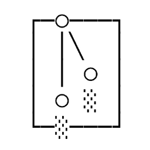

<div align="center">



# Gitleaks

**Find secrets in Git repositories, files and standard input.**

[](https://snapcraft.io/gitleaks)
[](https://snapcraft.io/core26)

[](https://snapcraft.io/publisher/sidaliteir)


[Getting Started](#getting-started) · [Configure](#configure) · [Limitations](#limitations) · [Build](#build) · [Support](#support) · [License](#license)

Unofficial snap packaging for [Gitleaks](https://github.com/gitleaks/gitleaks), a scanner that detects passwords, API keys and tokens in Git history, files and piped text.

</div>

---

## Getting Started

<a href="https://snapcraft.io/gitleaks"></a>

```bash
sudo snap install gitleaks
cd ~/my-project
gitleaks git -v
```

## Configure

This snap has no `snap set` options, and Gitleaks keeps no data of its own.
The Git included in the snap reads its configuration from `~/snap/gitleaks/current`, not from your own `~/.gitconfig`.

For repositories under `/media` or `/mnt`:

```bash
sudo snap connect gitleaks:removable-media
```

## Limitations

- Repositories, files and reports must be in a normal folder under your home directory or on connected removable storage. Hidden folders directly under your home directory are not accessible, but hidden files inside a project, such as `.env`, are scanned.
- Check the log as well as the exit code: an unreadable folder or a Git error can still end with `no leaks found`.
- Git cannot run host programs that a repository's configuration calls, such as a textconv driver or the Git LFS filter.

## Build

```bash
git clone https://github.com/sidalit/gitleaks-snap.git
cd gitleaks-snap
sudo snap install snapcraft --classic
snapcraft pack
```

## Support

- **Installation or snap issues:** [open a packaging issue](https://github.com/sidalit/gitleaks-snap/issues).
- **Application bugs:** [report them upstream](https://github.com/gitleaks/gitleaks/issues).

## License

Snap packaging: [MIT](https://github.com/sidalit/gitleaks-snap/blob/main/LICENSE).
